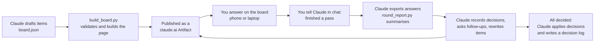
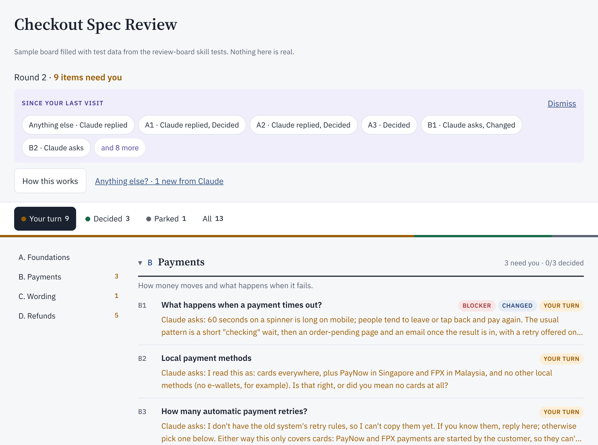
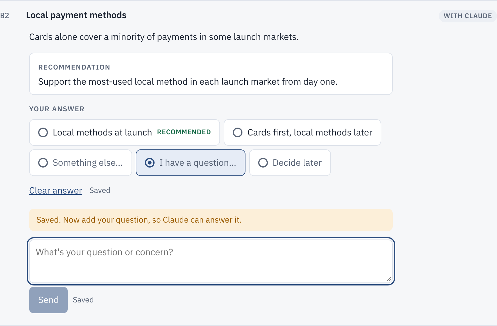
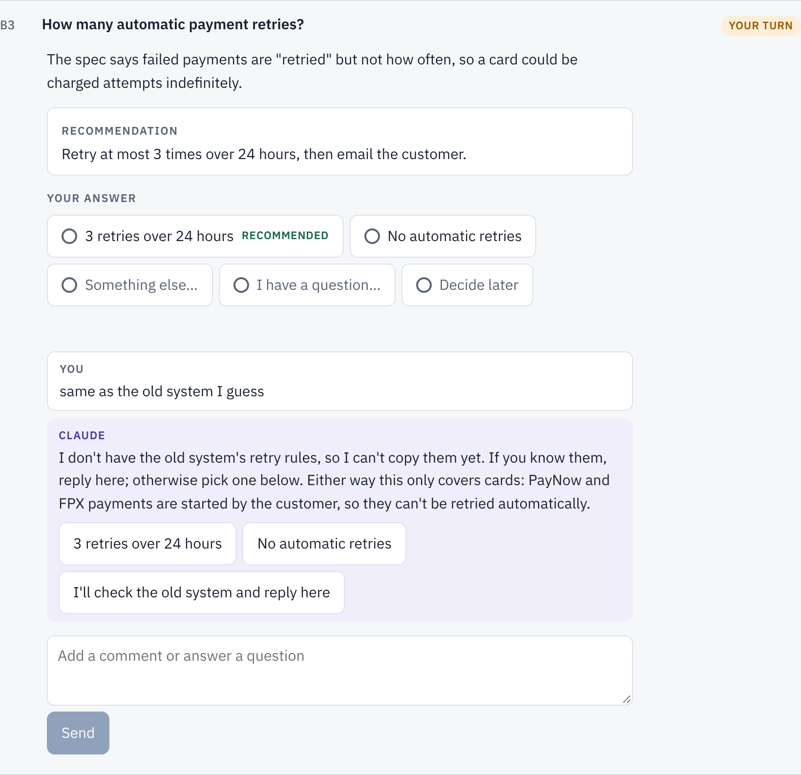
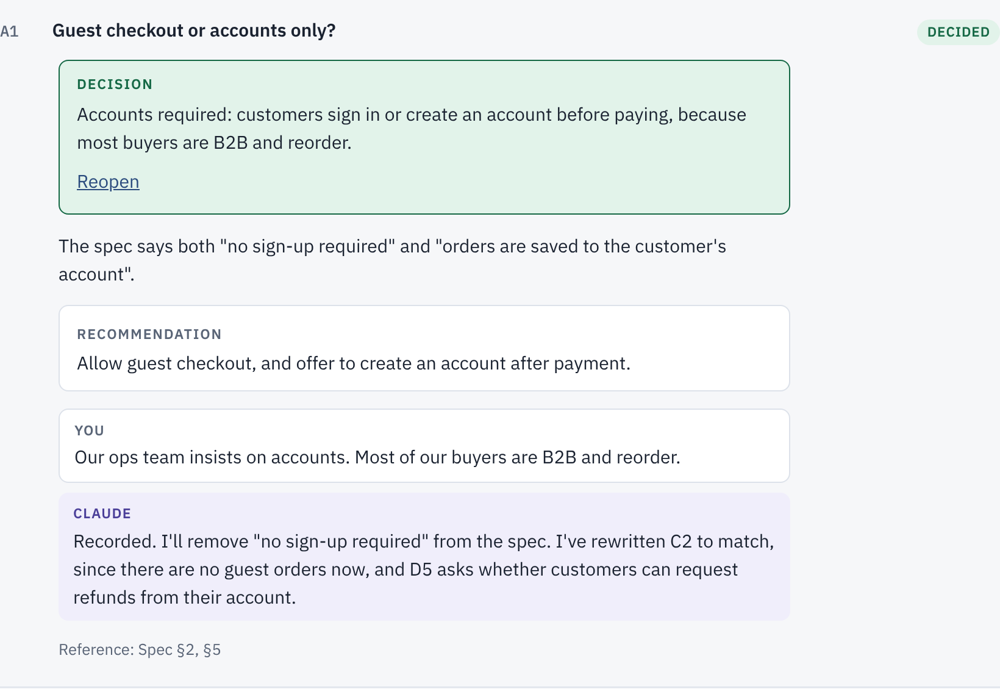
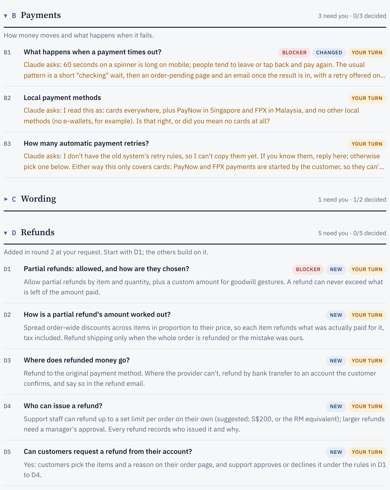
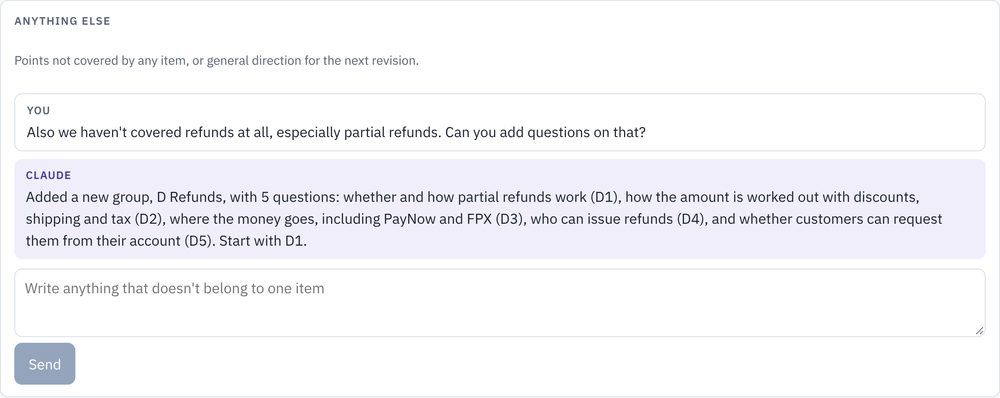
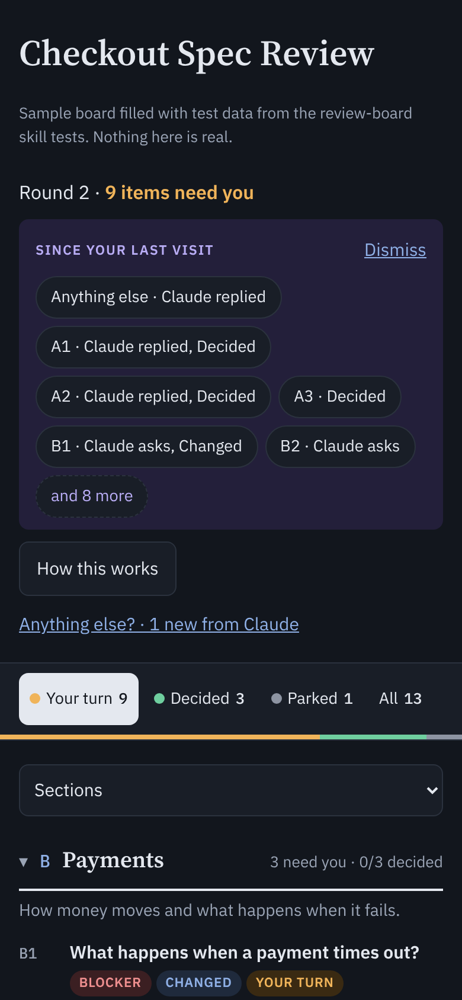
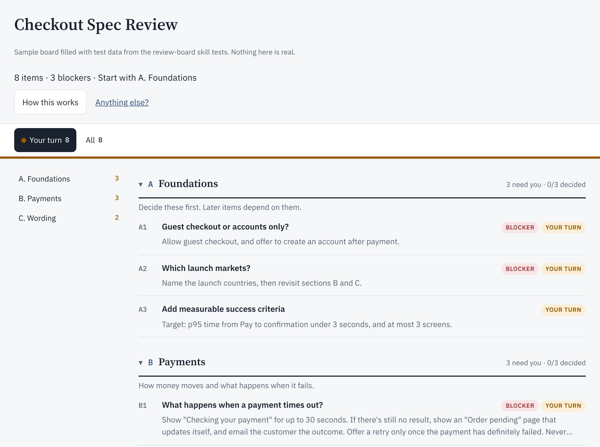

# Review board: design and usage

A review board turns a long critique or a pile of open decisions into a page you work through at your own pace, on phone or laptop. Claude reads your answers straight from the page. You never paste anything back into chat.

The screenshots use a sample checkout-spec review partway through: one round answered, Claude's replies posted, a second round waiting. The sample and the script that takes the screenshots are in [`sample/`](sample/). The skill itself is in [`skills/review-board`](../../skills/review-board/SKILL.md).

## How a review runs

Claude only ever writes the item list (`board.json`). The page is a fixed template, so every board looks and behaves the same, and no HTML is written per review.

## The board after a round

- **Status line:** how many items need you. On day one it says how many items and blockers there are, and where to start.
- **Since your last visit:** what Claude changed while you were away: replies, decisions, follow-up questions, rewritten and new items. Tap one to jump to it.
- **Tabs:** each item is in exactly one state. The coloured bar under the tabs shows the proportions.
- **Sections:** on the left on wide screens, with a count of items that need you. Fully decided sections start collapsed on the All tab.
- **Collapsed rows:** the ID, the title, status labels and one summary line. The summary shows Claude's question if there is one, otherwise the decision, your answer or the recommendation.

### Item states

| State | Meaning | What happens next |
|---|---|---|
| **Your turn** | Not answered yet, or Claude asked a follow-up | You answer |
| **With Claude** | You answered or commented; Claude hasn't replied | Claude replies in the next round |
| **Decided** | Claude recorded a decision | Nothing, unless you reopen it |
| **Parked** | Deliberately put off | Stays open. Claude lists it as unresolved when the review closes; you can answer it any time |

Extra labels appear only on items waiting for you:
- **Blocker:** work can't sensibly continue without it.
- **New:** added in a later round. Shown until you first answer or comment on it.
- **Changed:** rewritten since you last answered or commented on it, usually because of another answer.

## Answering an item

Every item offers the same kinds of answer:

| Answer | Meaning |
|---|---|
| **One of the options**, or **Accept recommendation** | You've decided, and the choice offered fits |
| **Something else…** | You've decided, but differently. Say what in the comment box |
| **I have a question…** | You haven't decided yet; you need information first |
| **Decide later** | Park it |

Every click saves immediately. To undo any answer, click it again or use **Clear answer**. "Something else…" and "I have a question…" open the comment box right under the buttons, because Claude needs the comment to act on them.

## Follow-up questions from Claude

When an answer is ambiguous, Claude asks rather than guesses. The item goes back to **Your turn**, and the question comes with one-tap replies. Each item has its own thread, and nothing in it is ever overwritten.

## Decided items

A decided item leads with the decision, followed by the original issue, the recommendation and the conversation that led there. **Reopen** sends it back to Claude with your reason.

## New and changed items

Answers can change the premise of other items. Here, Claude rewrote B1 after a question about payment timeouts (**Changed**), and a general note asking about refunds produced a new section D (**New**). Section C is folded away to save space.

An item you hadn't answered yet gets no Changed label when it is rewritten; it still appears under "Since your last visit".

## Anything else

For points that don't belong to any one item. Claude reads these too, and usually turns them into new items.

## On a phone

The board works on phone and laptop, in light and dark mode:
- the section list becomes a picker above the list;
- labels move under the title;
- the sticky tab bar stays one row.

Answers sync between devices.

## Day one

A new board opens on **Your turn**, starting with the Foundations section: the decisions that most other items depend on.

## Design choices

- **One state per item, shown everywhere:** in the tabs, the bar, the labels and the section counts. You always know what is waiting on you.
- **Collapsed by default.** A board can hold 50 or more items. Each row shows only what you need to decide whether to open it.
- **Answers save at once,** and there is one way to undo them.
- **Threads are append-only.** Claude never edits or deletes your answers or comments; it only adds replies, decisions and follow-ups.
- **Fixed template, data only.** Claude writes `board.json`; `build_board.py` validates it and fills in the page. This keeps boards consistent and saves tokens.

## Changing the page

The page is [`skills/review-board/assets/board-template.html`](../../skills/review-board/assets/board-template.html). Keep its data contract ([`references/data-model.md`](../../skills/review-board/references/data-model.md)) backward compatible, so existing boards keep working. After a change, from the repository root:
1. run the tests: `python3 tests/review-board/test_scripts.py` and `node tests/review-board/test_page.js`;
2. retake the screenshots with `node docs/review-board/sample/shoot.js` and look at them: phone and desktop widths, light and dark mode;
3. if you changed how Claude should behave, rerun the skill evals in `skills/review-board/evals/`.

The browser tests and the screenshot script use Playwright with Chromium. They drive the real page with a fake in-memory database, so they need no claude.ai account.
